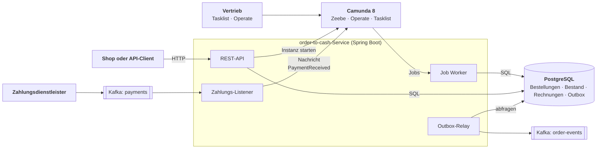

# Order-to-Cash mit Camunda 8

[](https://github.com/AhadPorkar/bpmn-order-workflow/actions/workflows/ci.yml)
[](LICENSE)


[English](README.md) · **Deutsch**

Ein vollständiger Order-to-Cash-Workflow auf Camunda 8, vom Eingang einer Bestellung bis zur bezahlten und versandten
Lieferung. Er deckt auch die Wege ab, die echte Bestellungen nehmen: Ware, die ausgeht, eine Vertriebsleiterin, die
einen Großauftrag ablehnt, und Kunden, die nie bezahlen. Der Service ist in Java 21 mit Spring Boot geschrieben,
spricht über Job Worker mit der Zeebe-Engine, empfängt Zahlungsbestätigungen über Kafka, speichert seine Daten in
PostgreSQL und veröffentlicht Bestellereignisse über eine Transactional Outbox. Ein `docker compose up` startet alles.


## Was der Prozess abdeckt

| Situation | Was passiert | Endstatus der Bestellung |
| --- | --- | --- |
| Alles auf Lager, kleiner Auftrag, pünktlich bezahlt | Bestand prüfen, entscheiden, reservieren, Rechnung stellen, Zahlung empfangen, versenden | `SHIPPED` |
| Großauftrag (Regeln in der [Entscheidungstabelle](src/main/resources/dmn/order-approval.dmn)) | In Tasklist erscheint eine Benutzeraufgabe mit Formular für die Gruppe `sales` | weiter oder `DECLINED` |
| Produkt bei der Bestandsprüfung ausverkauft | Der Kunde wird informiert | `REJECTED` |
| Ein anderer Auftrag nimmt den Bestand zwischen Prüfung und Reservierung | Der Worker wirft den BPMN-Fehler `OUT_OF_STOCK`; gleicher Weg wie bei „ausverkauft“ | `REJECTED` |
| Zahlung verspätet | Ein nicht unterbrechender Timer verschickt eine Zahlungserinnerung; die Bestellung wartet weiter | `AWAITING_PAYMENT` |
| Zahlungsziel abgelaufen | Kompensation gibt den Bestand frei und storniert die Rechnung, danach wird die Bestellung storniert | `CANCELLED` |
| Zahlung kommt an, bevor die Instanz darauf wartet | Die Nachricht wird gepuffert (Time to Live) und korreliert, sobald die Instanz so weit ist | `SHIPPED` |
| Dieselbe Zahlung wird zweimal zugestellt | Die Engine lehnt die zweite Nachricht anhand ihrer ID ab; nichts wird doppelt versandt | `SHIPPED` |

Die Entscheidungstabelle legt außerdem Zahlungsziel und Erinnerungszeitpunkt je Kundensegment fest: Neukunden zahlen
innerhalb von 7 Tagen, Standardkunden innerhalb von 14 und Goldkunden innerhalb von 30 Tagen.

## Verwendete BPMN- und DMN-Elemente

| Element | Wo | Warum |
| --- | --- | --- |
| Service Tasks mit Job Workern | Bestand, Rechnung, Versand, Benachrichtigungen | Die Geschäftslogik bleibt in einfachen Spring-Services |
| Business Rule Task (DMN, Hit Policy FIRST) | *Decide approval and payment terms* | Regeln, die der Vertrieb lesen und ohne Codeänderung anpassen kann |
| User Task mit Camunda-Formular und Kandidatengruppe | *Approve order* | Über Großaufträge entscheidet ein Mensch in Tasklist |
| Exklusive Gateways mit Default Flows | drei Entscheidungen | Keine Instanz bleibt an einer nicht erfüllten Bedingung hängen |
| Error Boundary Event | *Reserve stock* | Ein fachlicher Fehler nimmt einen modellierten Weg statt eines Incidents |
| Receive Task mit Message Correlation | *Wait for payment* | Correlation Key `orderId`, Message-ID `paymentId`, Time to Live |
| Timer Boundary Events, Dauer aus DMN | Erinnerung (nicht unterbrechend) und Frist (unterbrechend) | Mahnwesen ohne eigenen Scheduler im Service |
| Kompensation (Boundary Events, Handler, Throw Event) | *Release stock*, *Cancel invoice* | Abgeschlossene Schritte rückgängig machen, ohne verteilte Transaktionen |

## Architektur



Der Service besitzt seine Daten, die Engine den Prozesszustand jeder Bestellung. Worker sind dünne Adapter, die
idempotente Services aufrufen, denn die Engine liefert jeden Job mindestens einmal aus. Details, auch zum Verhalten bei
jeder Art von Fehler, stehen in [docs/de/architecture.md](docs/de/architecture.md).

## Schnellstart

Benötigt werden Docker mit Compose v2 und etwa 6 GB Arbeitsspeicher für Docker. Java braucht man nur für einen Build
außerhalb von Docker.

```bash
git clone https://github.com/AhadPorkar/bpmn-order-workflow.git
cd bpmn-order-workflow
docker compose up -d --build     # der erste Start dauert einige Minuten
./scripts/demo.sh                # legt eine Bestellung an, bezahlt sie und wartet auf den Versand
```

| Was | Wo |
| --- | --- |
| Bestell-API | <http://localhost:8081/api/orders> |
| Operate (laufende und beendete Instanzen) | <http://localhost:8088/operate>, Benutzer `demo`, Passwort `demo` |
| Tasklist (Großaufträge freigeben) | <http://localhost:8088/tasklist>, Benutzer `demo`, Passwort `demo` |
| Bestellereignisse in Kafka | `./scripts/consume-events.sh` |
| Health und Metriken | <http://localhost:8081/actuator/health>, `/actuator/prometheus` |

Weitere Wege zum Ausprobieren, mit fertigen Requests in [requests.http](requests.http):

```bash
# Goldkunde, 62.500 EUR: die Bestellung wartet in Tasklist auf Freigabe
curl -s -X POST localhost:8081/api/orders -H 'Content-Type: application/json' \
  -d '{"customerId":"customer-gold","customerSegment":"GOLD","lines":[{"sku":"SKU-SERVER","quantity":5}]}'

# Ausverkauftes Produkt: die Bestellung wird abgelehnt
curl -s -X POST localhost:8081/api/orders -H 'Content-Type: application/json' \
  -d '{"customerId":"customer-7","customerSegment":"STANDARD","lines":[{"sku":"SKU-SOLDOUT","quantity":1}]}'
```

Um den Service stattdessen aus der IDE zu starten, nur die Infrastruktur und dann die Anwendung hochfahren:

```bash
docker compose up -d orchestration elasticsearch postgres kafka
./mvnw spring-boot:run
```

## API

| Methode und Pfad | Zweck | Antworten |
| --- | --- | --- |
| `POST /api/orders` | Bestellung anlegen; Preise kommen aus dem Katalog, nie vom Client | `201` mit `Location`, `400` ungültig, `422` unbekannte SKU, `503` Engine nicht erreichbar |
| `GET /api/orders/{id}` | Bestellung mit Status, Rechnung, Zahlung und Process Instance Key | `200`, `404` |
| `POST /api/orders/{id}/payments` | Simuliert den Zahlungsdienstleister; schreibt in das Topic `payments` | `202`, `404`, `409` wenn die Bestellung bereits abgeschlossen ist |
| `GET /api/products` | Katalog mit verfügbarem und reserviertem Bestand | `200` |

Fehler werden als RFC 9457 Problem Details geliefert. Der Status einer Bestellung wechselt von `RECEIVED` über
`AWAITING_PAYMENT` zu `SHIPPED` oder endet in `REJECTED`, `DECLINED` oder `CANCELLED`.

## Tests

```bash
./mvnw verify      # benötigt Docker für Testcontainers
```

| Ebene | Test | Was er nachweist |
| --- | --- | --- |
| Prozess | [`OrderToCashProcessTest`](src/test/java/io/github/ahadporkar/ordertocash/process/OrderToCashProcessTest.java) | Jeden Weg des Modells, einschließlich einer doppelten Zahlung, mit gemockten Workern und gesteuerter Uhr: 14 Tage vergehen in Millisekunden |
| Entscheidung | [`OrderApprovalDecisionTest`](src/test/java/io/github/ahadporkar/ordertocash/process/OrderApprovalDecisionTest.java) | Jede Regel der Entscheidungstabelle und ihre Grenzwerte, einschließlich der getroffenen Regel |
| Unit | [`InventoryWorkersTest`](src/test/java/io/github/ahadporkar/ordertocash/process/InventoryWorkersTest.java), [`OrderServiceTest`](src/test/java/io/github/ahadporkar/ordertocash/order/OrderServiceTest.java), [`OrderControllerTest`](src/test/java/io/github/ahadporkar/ordertocash/order/OrderControllerTest.java) | Abbildung von Worker-Fehlern auf BPMN-Fehler; Anlegen einer Bestellung bei nicht erreichbarer Engine; HTTP-Statuscodes und Validierung |
| Integration | [`InventoryServiceIT`](src/test/java/io/github/ahadporkar/ordertocash/inventory/InventoryServiceIT.java), [`OutboxRepositoryIT`](src/test/java/io/github/ahadporkar/ordertocash/events/OutboxRepositoryIT.java) | Idempotente Alles-oder-nichts-Reservierungen und die Outbox auf einem echten PostgreSQL |
| End-to-End | [`OrderToCashIT`](src/test/java/io/github/ahadporkar/ordertocash/OrderToCashIT.java) | Echte Worker, PostgreSQL, Kafka und Camunda: eine Zahlung über Kafka führt zum Versand; eine unbezahlte Bestellung wird nach Ablauf des Zahlungsziels storniert, Bestand und Rechnung werden zurückgenommen |

Die Überlegungen hinter dieser Aufteilung stehen in [docs/de/testing.md](docs/de/testing.md).

## Architekturentscheidungen

| ADR | Entscheidung |
| --- | --- |
| [0001](docs/de/adr/0001-orchestrate-with-bpmn-on-camunda-8.md) | Die Bestellung wird mit BPMN auf Camunda 8 orchestriert statt per Event-Choreografie |
| [0002](docs/de/adr/0002-idempotent-job-workers.md) | Jeder Job Worker ist idempotent, weil Jobs mindestens einmal zugestellt werden |
| [0003](docs/de/adr/0003-compensation-instead-of-distributed-transactions.md) | BPMN-Kompensation statt verteilter Transaktionen |
| [0004](docs/de/adr/0004-business-rules-in-a-dmn-table.md) | Freigaberegeln und Zahlungsziele stehen in einer DMN-Tabelle |
| [0005](docs/de/adr/0005-payments-via-kafka-with-message-id-and-ttl.md) | Zahlungen kommen über Kafka und werden mit Message-ID und Time to Live korreliert |
| [0006](docs/de/adr/0006-transactional-outbox-for-order-events.md) | Bestellereignisse laufen über eine Transactional Outbox |
| [0007](docs/de/adr/0007-commit-the-order-before-starting-the-process.md) | Die Bestellung wird gespeichert, bevor ihre Prozessinstanz startet |
| [0008](docs/de/adr/0008-test-pyramid-with-camunda-process-test.md) | Eine Testpyramide auf Basis von Camunda Process Test und Testcontainers |

## Konfiguration

| Property | Standard | Bedeutung |
| --- | --- | --- |
| `app.messaging.mode` | `kafka` | `kafka` nutzt die Topics; `direct` korreliert Zahlungen im Prozess (ohne Kafka) |
| `app.kafka.payments-topic` | `payments` | eingehende Zahlungsbestätigungen; Fehlschläge landen in `payments-dlt` |
| `app.kafka.events-topic` | `order-events` | ausgehende Bestellereignisse, mit der Bestell-ID als Schlüssel |
| `app.kafka.outbox-poll-interval-ms` | `1000` | wie oft das Outbox-Relay nach neuen Ereignissen sucht |
| `app.payments.message-time-to-live` | `PT1H` | wie lange eine verfrühte Zahlung auf ihre Instanz wartet |
| `camunda.client.grpc-address`, `camunda.client.rest-address` | `http://localhost:26500`, `http://localhost:8088` | Camunda-8-Gateway |

## Projektstruktur

```text
.
├── src/main/java/.../ordertocash
│   ├── order/        REST-API, Lebenszyklus der Bestellung, Repository
│   ├── inventory/    Bestandsprüfung und Reservierung
│   ├── billing/      Rechnungen
│   ├── payment/      Zahlungs-Gateway (Kafka oder direkt) und Listener
│   ├── process/      Job Worker, Prozessstart, Message Correlation
│   ├── events/       Transactional Outbox und Relay nach Kafka
│   └── config/       Properties, Kafka-Topics und Fehlerbehandlung, Problem Details
├── src/main/resources
│   ├── bpmn/         order-to-cash.bpmn
│   ├── dmn/          order-approval.dmn
│   ├── forms/        approve-order.form
│   └── db/migration/ Flyway-Skripte
├── src/test/java     Prozess-, Entscheidungs-, Unit-, Integrations- und End-to-End-Tests
├── docs/             Architektur, Tests, ADRs (en, de), Release Notes
├── scripts/          Demo- und Kafka-Hilfsskripte
├── docker-compose.yml, Dockerfile
└── .github/          CI, Release nach GHCR, Dependabot
```

Die Dateien `.bpmn`, `.dmn` und `.form` lassen sich im [Camunda Desktop Modeler](https://camunda.com/download/modeler/)
öffnen und bearbeiten.

## Grenzen

Dies ist eine Referenzimplementierung, kein Shop. Bewusst nicht enthalten sind:

- der Abgleich des gezahlten Betrags mit der Rechnung (Teilzahlungen, Überzahlungen, Erstattungen);
- Authentifizierung an der Bestell-API; Camunda läuft mit dem Demo-Benutzer;
- ein Benachrichtigungsdienst: Kundenbenachrichtigungen sind Ereignisse in `order-events`, die ein anderer Service
  versendet;
- ein Produktivbetrieb: die Compose-Datei ist für die lokale Entwicklung gedacht.

## Über den Autor

**Ahad Porkar**, Senior Software Engineer und Solution Architect. Ich arbeite mit Java, .NET und BPMN/Camunda. Die
Architektur einer BPM-Plattform, die ich mit meinem Team gebaut habe, beschreibe ich in
[bpms-architecture-notes](https://github.com/AhadPorkar/bpms-architecture-notes).

[ahadporkar.com](https://ahadporkar.com) · [LinkedIn](https://www.linkedin.com/in/seapr) ·
[GitHub](https://github.com/AhadPorkar) · [porkar.ahad@gmail.com](mailto:porkar.ahad@gmail.com)

## Lizenz

[MIT](LICENSE)
