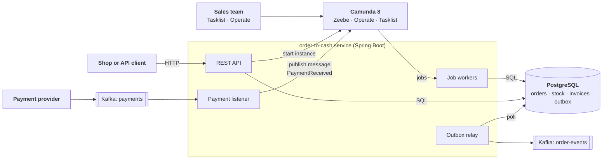

# Order-to-cash with Camunda 8

[](https://github.com/AhadPorkar/bpmn-order-workflow/actions/workflows/ci.yml)
[](LICENSE)


**English** · [Deutsch](README.de.md)

A complete order-to-cash workflow on Camunda 8, from an incoming order to a paid and shipped one. It covers the paths
that real orders take as well: stock that runs out, a sales manager who declines a large order, and a customer who
never pays. The service is written in Java 21 with Spring Boot, talks to the Zeebe engine through job workers, takes
payment confirmations from Kafka, keeps its data in PostgreSQL and publishes order events through a transactional
outbox. One `docker compose up` starts everything.


## What the process handles

| Situation | What happens | Final order status |
| --- | --- | --- |
| Everything in stock, small order, paid on time | Check stock, decide, reserve, invoice, receive payment, ship | `SHIPPED` |
| Large order (rules in the [decision table](src/main/resources/dmn/order-approval.dmn)) | A user task appears in Tasklist for the `sales` group, with a form | continues or `DECLINED` |
| Product sold out at the stock check | The customer is informed | `REJECTED` |
| Stock taken by another order between check and reservation | The worker throws the BPMN error `OUT_OF_STOCK`; same path as sold out | `REJECTED` |
| Payment is late | A non-interrupting timer sends a reminder; the order keeps waiting | `AWAITING_PAYMENT` |
| Payment term expires | Compensation releases the stock and cancels the invoice, then the order is cancelled | `CANCELLED` |
| Payment arrives before the instance waits for it | The message is buffered (time to live) and correlated when the instance gets there | `SHIPPED` |
| The same payment is delivered twice | The engine rejects the second message by its id; nothing ships twice | `SHIPPED` |

The decision table also sets the payment term and the reminder time per customer segment, so new customers pay
within 7 days, standard customers within 14 and gold customers within 30.

## BPMN and DMN features used

| Feature | Where | Why |
| --- | --- | --- |
| Service tasks with job workers | stock, invoice, shipping, notifications | business logic stays in plain Spring services |
| Business rule task (DMN, hit policy FIRST) | *Decide approval and payment terms* | rules that sales can read and change without a code change |
| User task with a Camunda form and candidate group | *Approve order* | a person decides on large orders in Tasklist |
| Exclusive gateways with default flows | three decisions | no instance gets stuck on an unmatched condition |
| Error boundary event | *Reserve stock* | a business failure takes a modeled path instead of an incident |
| Receive task with message correlation | *Wait for payment* | correlation key `orderId`, message id `paymentId`, time to live |
| Timer boundary events, durations from DMN | reminder (non-interrupting) and deadline (interrupting) | dunning without a scheduler in the service |
| Compensation (boundary events, handlers, throw event) | *Release stock*, *Cancel invoice* | undo completed steps without distributed transactions |

## Architecture



The service owns its data; the engine owns the state of each order's process. Workers are thin adapters that call
idempotent services, because the engine delivers each job at least once. Details, including what happens on every
kind of failure, are in [docs/en/architecture.md](docs/en/architecture.md).

## Quick start

You need Docker with Compose v2 and about 6 GB of memory for Docker. Java is only needed to build outside Docker.

```bash
git clone https://github.com/AhadPorkar/bpmn-order-workflow.git
cd bpmn-order-workflow
docker compose up -d --build     # first start takes a few minutes
./scripts/demo.sh                # places an order, pays it, waits until it ships
```

| What | Where |
| --- | --- |
| Order API | <http://localhost:8081/api/orders> |
| Operate (running and finished instances) | <http://localhost:8088/operate>, user `demo`, password `demo` |
| Tasklist (approve large orders) | <http://localhost:8088/tasklist>, user `demo`, password `demo` |
| Order events on Kafka | `./scripts/consume-events.sh` |
| Health and metrics | <http://localhost:8081/actuator/health>, `/actuator/prometheus` |

More paths to try, with ready-made requests in [requests.http](requests.http):

```bash
# Gold customer, 62,500 EUR: the order waits for approval in Tasklist
curl -s -X POST localhost:8081/api/orders -H 'Content-Type: application/json' \
  -d '{"customerId":"customer-gold","customerSegment":"GOLD","lines":[{"sku":"SKU-SERVER","quantity":5}]}'

# Sold-out product: the order is rejected
curl -s -X POST localhost:8081/api/orders -H 'Content-Type: application/json' \
  -d '{"customerId":"customer-7","customerSegment":"STANDARD","lines":[{"sku":"SKU-SOLDOUT","quantity":1}]}'
```

To run the service from your IDE instead, start only the infrastructure and then the application:

```bash
docker compose up -d orchestration elasticsearch postgres kafka
./mvnw spring-boot:run
```

## API

| Method and path | Purpose | Responses |
| --- | --- | --- |
| `POST /api/orders` | Place an order; prices come from the catalog, never from the client | `201` with `Location`, `400` invalid, `422` unknown SKU, `503` engine unreachable |
| `GET /api/orders/{id}` | Order with status, invoice, payment and process instance key | `200`, `404` |
| `POST /api/orders/{id}/payments` | Simulates the payment provider; publishes to the `payments` topic | `202`, `404`, `409` if the order is already closed |
| `GET /api/products` | Catalog with available and reserved stock | `200` |

Errors use RFC 9457 problem details. Order status moves from `RECEIVED` to `AWAITING_PAYMENT` to `SHIPPED`, or ends in
`REJECTED`, `DECLINED` or `CANCELLED`.

## Tests

```bash
./mvnw verify      # needs Docker for Testcontainers
```

| Level | Test | What it proves |
| --- | --- | --- |
| Process | [`OrderToCashProcessTest`](src/test/java/io/github/ahadporkar/ordertocash/process/OrderToCashProcessTest.java) | Every path of the model, including a duplicate payment, with mocked workers and a controlled clock: 14 days pass in milliseconds |
| Decision | [`OrderApprovalDecisionTest`](src/test/java/io/github/ahadporkar/ordertocash/process/OrderApprovalDecisionTest.java) | Every rule of the decision table and its boundaries, including which rule matched |
| Unit | [`InventoryWorkersTest`](src/test/java/io/github/ahadporkar/ordertocash/process/InventoryWorkersTest.java), [`OrderServiceTest`](src/test/java/io/github/ahadporkar/ordertocash/order/OrderServiceTest.java), [`OrderControllerTest`](src/test/java/io/github/ahadporkar/ordertocash/order/OrderControllerTest.java) | Worker mapping to BPMN errors; order placement when the engine is down; HTTP status codes and validation |
| Integration | [`InventoryServiceIT`](src/test/java/io/github/ahadporkar/ordertocash/inventory/InventoryServiceIT.java), [`OutboxRepositoryIT`](src/test/java/io/github/ahadporkar/ordertocash/events/OutboxRepositoryIT.java) | Idempotent, all-or-nothing reservations and the outbox on a real PostgreSQL |
| End to end | [`OrderToCashIT`](src/test/java/io/github/ahadporkar/ordertocash/OrderToCashIT.java) | Real workers, PostgreSQL, Kafka and Camunda: payment via Kafka ships the order; an unpaid order is cancelled after its term with stock and invoice rolled back |

The reasoning behind this split is in [docs/en/testing.md](docs/en/testing.md).

## Design decisions

| ADR | Decision |
| --- | --- |
| [0001](docs/en/adr/0001-orchestrate-with-bpmn-on-camunda-8.md) | Orchestrate the order with BPMN on Camunda 8 instead of event choreography |
| [0002](docs/en/adr/0002-idempotent-job-workers.md) | Every job worker is idempotent, because jobs are delivered at least once |
| [0003](docs/en/adr/0003-compensation-instead-of-distributed-transactions.md) | BPMN compensation instead of distributed transactions |
| [0004](docs/en/adr/0004-business-rules-in-a-dmn-table.md) | Approval rules and payment terms live in a DMN table |
| [0005](docs/en/adr/0005-payments-via-kafka-with-message-id-and-ttl.md) | Payments arrive via Kafka and are correlated with a message id and a time to live |
| [0006](docs/en/adr/0006-transactional-outbox-for-order-events.md) | Order events go through a transactional outbox |
| [0007](docs/en/adr/0007-commit-the-order-before-starting-the-process.md) | The order is committed before its process instance starts |
| [0008](docs/en/adr/0008-test-pyramid-with-camunda-process-test.md) | A test pyramid built on Camunda Process Test and Testcontainers |

## Configuration

| Property | Default | Meaning |
| --- | --- | --- |
| `app.messaging.mode` | `kafka` | `kafka` uses the topics; `direct` correlates payments in-process (no Kafka needed) |
| `app.kafka.payments-topic` | `payments` | incoming payment confirmations; failures go to `payments-dlt` |
| `app.kafka.events-topic` | `order-events` | outgoing order events, keyed by order id |
| `app.kafka.outbox-poll-interval-ms` | `1000` | how often the outbox relay looks for new events |
| `app.payments.message-time-to-live` | `PT1H` | how long an early payment waits for its instance |
| `camunda.client.grpc-address`, `camunda.client.rest-address` | `http://localhost:26500`, `http://localhost:8088` | Camunda 8 gateway |

## Project layout

```text
.
├── src/main/java/.../ordertocash
│   ├── order/        REST API, order lifecycle, repository
│   ├── inventory/    stock checks and reservations
│   ├── billing/      invoices
│   ├── payment/      payment gateway (Kafka or direct) and listener
│   ├── process/      job workers, process start, message correlation
│   ├── events/       transactional outbox and relay to Kafka
│   └── config/       properties, Kafka topics and error handling, problem details
├── src/main/resources
│   ├── bpmn/         order-to-cash.bpmn
│   ├── dmn/          order-approval.dmn
│   ├── forms/        approve-order.form
│   └── db/migration/ Flyway scripts
├── src/test/java     process, decision, unit, integration and end-to-end tests
├── docs/             architecture, testing, ADRs (en, de), release notes
├── scripts/          demo and Kafka helper scripts
├── docker-compose.yml, Dockerfile
└── .github/          CI, release to GHCR, Dependabot
```

Open the `.bpmn`, `.dmn` and `.form` files in the [Camunda Desktop Modeler](https://camunda.com/download/modeler/)
to see and change the model.

## Limitations

This is a reference implementation, not a shop. On purpose, it does not include:

- reconciliation of the paid amount with the invoice (partial payments, over-payments, refunds);
- authentication on the order API; Camunda runs with its demo user;
- a notification service: customer notifications are events on `order-events` for another service to send;
- a production deployment: the compose file is for local development.

## About the author

**Ahad Porkar**, senior software engineer and solution architect. I work with Java, .NET and BPMN/Camunda. For the
architecture of a BPM platform I built with my team, see
[bpms-architecture-notes](https://github.com/AhadPorkar/bpms-architecture-notes).

[ahadporkar.com](https://ahadporkar.com) · [LinkedIn](https://www.linkedin.com/in/seapr) ·
[GitHub](https://github.com/AhadPorkar) · [porkar.ahad@gmail.com](mailto:porkar.ahad@gmail.com)

## License

[MIT](LICENSE)
