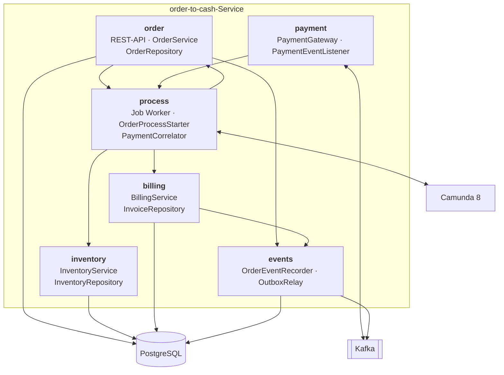
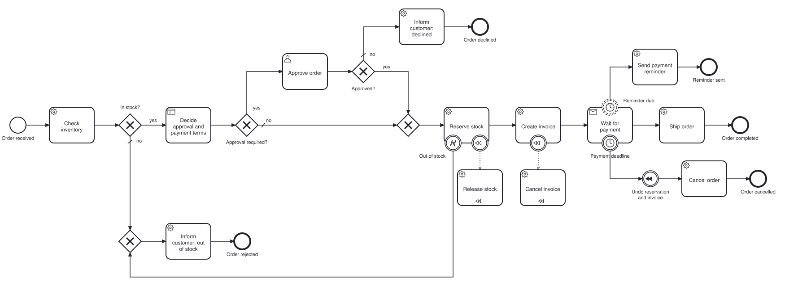
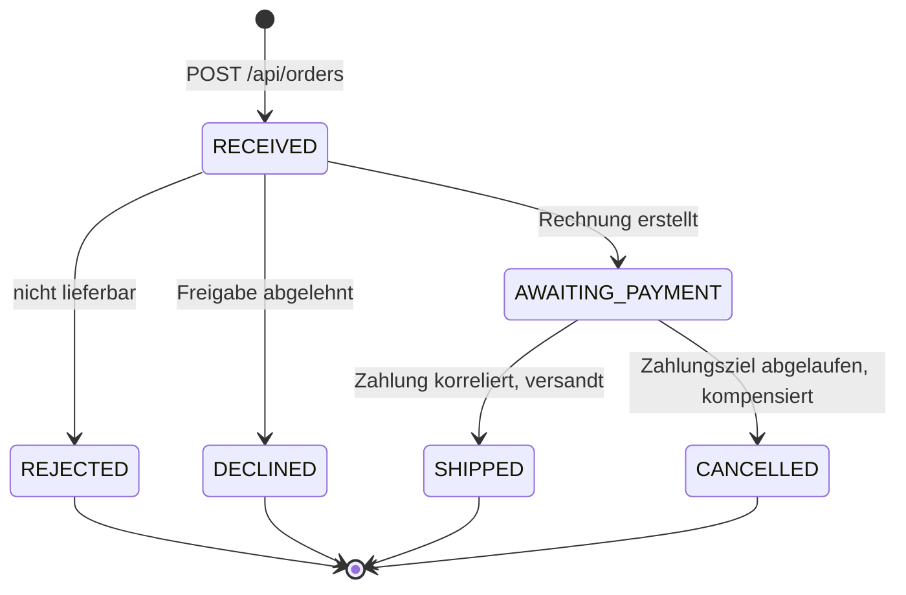
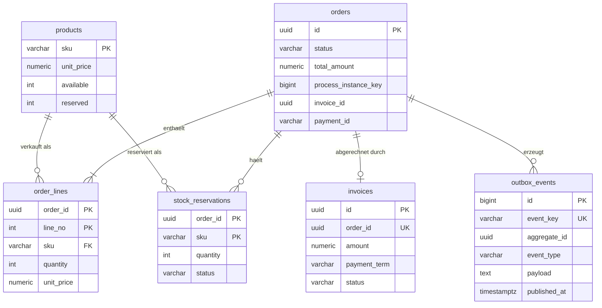
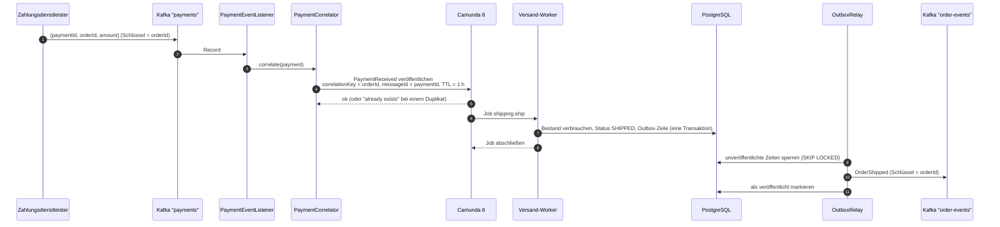

# Architektur

[English](../en/architecture.md) · **Deutsch**

Dieses Dokument beschreibt, wie der Order-to-Cash-Service aufgebaut ist: seine Bausteine, den Weg einer Bestellung
durch den Prozess, was wo gespeichert wird und was bei Fehlern passiert. Die Entscheidungen dahinter sind als
[ADRs](adr/README.md) festgehalten.

## 1. Umfang und Qualitätsziele

Der Service nimmt Bestellungen an, reserviert Bestand, stellt Rechnungen aus, wartet auf die Zahlung und versendet.
Kunden, Zahlungen und Versand sind vereinfacht, denn Gegenstand dieses Repositorys ist die Orchestrierung um sie herum.

| Qualitätsziel | Bedeutung hier | Wie es erreicht wird |
| --- | --- | --- |
| Korrektheit bei Wiederholungen | Keine Bestellung wird doppelt versandt, kein Bestand doppelt reserviert, keine Rechnung doppelt gestellt | Idempotente Services, eindeutige Schlüssel, Message-IDs ([ADR 0002](adr/0002-idempotent-job-workers.md)) |
| Wiederherstellbarkeit | Jede Bestellung endet in einem definierten Status, auch wenn sie nie bezahlt wird | Timer und Kompensation im Modell ([ADR 0003](adr/0003-compensation-instead-of-distributed-transactions.md)) |
| Nachvollziehbarkeit | Jeder kann sehen, wo eine Bestellung steht und warum | Eine Prozessinstanz pro Bestellung, sichtbar in Operate |
| Änderbarkeit | Der Vertrieb kann Freigabegrenzen und Zahlungsziele ändern | Regeln in einer DMN-Tabelle ([ADR 0004](adr/0004-business-rules-in-a-dmn-table.md)) |
| Testbarkeit | Jeder Weg ist in Sekunden testbar, auch solche, die Wochen dauern | Camunda Process Test mit gesteuerter Uhr ([ADR 0008](adr/0008-test-pyramid-with-camunda-process-test.md)) |

## 2. Bausteine



| Paket | Verantwortung | Spricht mit |
| --- | --- | --- |
| `order` | REST-API, Preisbildung, Bestellstatus, Lebenszyklus der Bestellung | Datenbank, Prozessstart, Outbox |
| `inventory` | Bestandsprüfung, Reservierung, Freigabe, Verbrauch | Datenbank |
| `billing` | Rechnungserstellung und -stornierung | Datenbank, Outbox |
| `process` | Job Worker (dünne Adapter), Start von Instanzen, Veröffentlichen der Zahlungsnachricht | Camunda, die Services oben |
| `payment` | Zahlungs-Gateway (`kafka` oder `direct`) und Kafka-Listener | Kafka, `PaymentCorrelator` |
| `events` | schreibt Ereignisse in der Transaktion des Aufrufers in die Outbox, leitet sie an Kafka weiter | Datenbank, Kafka |

Zwei Regeln halten die Teile getrennt. Erstens: **Der Prozess kennt fachliche Schlüssel, keine fachlichen Daten.**
Eine Instanz trägt `orderId`, `customerId`, `customerSegment`, `totalAmount` und `currency`, aber nie die
Bestellpositionen; Worker laden, was sie brauchen, aus der Datenbank. Zweitens: **Worker enthalten keine
Geschäftslogik.** Sie übersetzen zwischen Job-Variablen und einem Service-Aufruf und zwischen einer fachlichen Ausnahme
und einem BPMN-Fehler.

## 3. Der Prozess Schritt für Schritt



| BPMN-Element | Job-Typ | Service-Aufruf | Wirkung in der Datenbank | Bestellereignis |
| --- | --- | --- | --- | --- |
| Check inventory | `inventory.check` | `InventoryService.isAvailable` | keine (nur lesend) | |
| Decide approval and payment terms | (DMN `order-approval`) | | | |
| Approve order | (User Task, Formular `approve-order`) | | | |
| Reserve stock | `inventory.reserve` | `InventoryService.reserve` | `available` sinkt, `reserved` steigt, eine Reservierung je SKU | |
| Create invoice | `invoice.create` | `BillingService.createInvoice` | Rechnungszeile; Bestellung `AWAITING_PAYMENT` | `OrderInvoiced` |
| Wait for payment | (Nachricht `PaymentReceived`) | | | |
| Ship order | `shipping.ship` | `OrderService.ship` | Reservierungen `SHIPPED`, `reserved` sinkt; Bestellung `SHIPPED` | `OrderShipped` |
| Send payment reminder | `customer.notify` | `OrderService.recordOutcome` | keine | `PaymentReminderDue` |
| Release stock (Kompensation) | `inventory.release` | `InventoryService.release` | Reservierungen `RELEASED`, Bestand zurückgebucht | |
| Cancel invoice (Kompensation) | `invoice.cancel` | `BillingService.cancelInvoice` | Rechnung `CANCELLED` | `InvoiceCancelled` |
| Cancel order | `order.cancel` | `OrderService.cancel` | Bestellung `CANCELLED` | `OrderCancelled` |
| Inform customer (abgelehnt / nicht lieferbar) | `customer.notify` | `OrderService.recordOutcome` | Bestellung `DECLINED` / `REJECTED` | `OrderDeclined` / `OrderRejected` |

Die Entscheidungstabelle liefert ein Objekt, `approval`, mit drei Feldern:

| Segment | Bestellsumme | `approvalRequired` | `paymentTerm` | `reminderAfter` |
| --- | --- | --- | --- | --- |
| `GOLD` | ≥ 50.000 | ja | 30 Tage | 21 Tage |
| `GOLD` | beliebig | nein | 30 Tage | 21 Tage |
| `NEW` | > 1.000 | ja | 7 Tage | 5 Tage |
| `NEW` | beliebig | nein | 7 Tage | 5 Tage |
| beliebig | > 10.000 | ja | 14 Tage | 10 Tage |
| beliebig | beliebig | nein | 14 Tage | 10 Tage |

Die beiden Timer an *Wait for payment* lesen ihre Dauer daraus: `=approval.reminderAfter` für die nicht unterbrechende
Erinnerung und `=approval.paymentTerm` für die unterbrechende Frist. Die Rechnung speichert dasselbe Zahlungsziel.

## 4. Bestellstatus



Der Status ist eine Projektion des Prozesses für die API und für Berichte. Die Prozessinstanz bleibt die Wahrheit
darüber, *wo* eine Bestellung steht; die Statusspalte beantwortet, *was* sie ist. Statusänderungen sind bedingt
(`WHERE status <> :status`), damit ein wiederholter Job kein zweites Ereignis erzeugt.

## 5. Datenmodell



Die Schlüssel tragen die Idempotenzregeln: eine Reservierung je Bestellung und SKU, eine Rechnung je Bestellung, ein
Ereignis je Bestellung und Ereignistyp. Bestand wird mit einem einzigen bedingten Update entnommen
(`available >= :qty`). So können zwei Bestellungen den letzten Artikel nicht doppelt verkaufen, und keine Zeilensperre
wird über einen Netzwerkaufruf hinweg gehalten.

## 6. Zahlungen rein, Ereignisse raus



Zahlungs-Records und Bestellereignisse haben beide die Bestell-ID als Schlüssel, damit alles zu einer Bestellung in
einer Partition und in Reihenfolge bleibt. `OrderReceived` wird in derselben Transaktion wie die Bestellung selbst
geschrieben und ist daher immer ihr erstes Ereignis; das Relay hält die Ereignisse einer Bestellung zurück, bis sie
ihre Prozessinstanz hat. Eine Bestellung, deren Prozess nicht gestartet werden konnte, wird so nie angekündigt. Ein
Ereignis in `order-events` sieht so aus:

```json
{
  "type": "OrderShipped",
  "orderId": "1f0c6c3e-8a51-4c9e-9d4b-2b8f3c7a9e10",
  "status": "SHIPPED",
  "occurredAt": "2026-10-01T09:30:12.481Z",
  "details": { "paymentId": "pay-7781" }
}
```

Ereignistypen: `OrderReceived`, `OrderInvoiced`, `PaymentReminderDue`, `OrderShipped`, `OrderRejected`,
`OrderDeclined`, `InvoiceCancelled`, `OrderCancelled`.

## 7. Wenn etwas schiefgeht

| Fehler | Was passiert | Warum das sicher ist |
| --- | --- | --- |
| Ein Worker stürzt nach dem Datenbank-Commit, aber vor dem Abschluss des Jobs ab | Der Job läuft in den Timeout und wird erneut aktiviert | Der Service-Aufruf ist idempotent; der zweite Aufruf ändert nichts |
| Ein Worker wirft eine unerwartete Ausnahme | Der Job hat bis zu drei Versuche (`retries="3"` im Modell), danach erscheint ein Incident in Operate | Nichts ist halb erledigt: jeder Service-Aufruf ist eine Transaktion |
| Bestand geht zwischen Prüfung und Reservierung aus | Der Worker wirft den BPMN-Fehler `OUT_OF_STOCK` | Die Reservierungstransaktion wurde zurückgerollt; das Modell nimmt den Ablehnungsweg |
| Die Engine ist beim Anlegen einer Bestellung nicht erreichbar | Die gespeicherte Bestellung und ihr unveröffentlichtes `OrderReceived` werden wieder gelöscht; die API antwortet `503` | Keine Bestellung existiert ohne Prozessinstanz ([ADR 0007](adr/0007-commit-the-order-before-starting-the-process.md)) |
| Dieselbe Zahlung wird zweimal zugestellt | Die zweite Veröffentlichung wird abgelehnt, weil die Message-ID existiert | Die Bestellung wird einmal versandt ([ADR 0005](adr/0005-payments-via-kafka-with-message-id-and-ttl.md)) |
| Eine Zahlung kommt, bevor die Instanz wartet | Die Nachricht wartet bis zu einer Stunde in der Engine | Sie wird korreliert, sobald die Instanz *Wait for payment* erreicht |
| Ein Zahlungs-Record ist kein gültiges JSON | Er geht sofort nach `payments-dlt`; andere Fehler werden vorher dreimal wiederholt | Ein fehlerhafter Record blockiert die Partition nicht |
| Kafka ist nicht verfügbar | Bestellereignisse bleiben in der Outbox; Zahlungen können nicht eingereicht werden (`/payments` schlägt fehl) | Das Relay veröffentlicht den Rückstand, sobald Kafka wieder da ist ([ADR 0006](adr/0006-transactional-outbox-for-order-events.md)) |
| Das Relay stürzt nach dem Senden, aber vor dem Markieren ab | Das Ereignis wird erneut gesendet | Konsumenten deduplizieren nach Bestell-ID und Ereignistyp |
| Der Kunde zahlt nie | Erinnerung nach `reminderAfter`, Frist nach `paymentTerm` | Die Kompensation gibt Bestand frei und storniert die Rechnung, danach wird die Bestellung storniert |
| Eine Zahlung kommt nach der Stornierung | Die API lehnt sie mit `409` ab; eine Zahlung über Kafka findet keine wartende Instanz und verfällt | Erstattungen liegen außerhalb dieses Services |

## 8. Modelle und Versionen ausrollen

Beim Start rollt der Service den BPMN-Prozess, die DMN-Entscheidung und das Formular aus (`@Deployment`). Eine
unveränderte Ressource erzeugt keine neue Version. Eine geänderte schon, und **laufende Instanzen bleiben auf der
Version, mit der sie gestartet wurden**, während neue Bestellungen die neueste Version verwenden. Instanzen werden
bewusst mit `latestVersion()` gestartet; eine Modelländerung, die laufende Instanzen erreichen muss, ist eine Migration
und wird ausdrücklich mit der Prozessinstanz-Migration in Operate durchgeführt. Der Prozess trägt außerdem einen
Version-Tag (`1.0.0`), der eine ausgerollte Version mit einem Release dieses Repositorys verbindet.

## 9. Das System beobachten

- **Operate** zeigt jede Instanz, ihre aktuelle Position, ihre Variablen und eventuelle Incidents.
- **Tasklist** zeigt offene Freigabeaufgaben für die Gruppe `sales`.
- **Actuator** stellt `/actuator/health` mit Liveness- und Readiness-Probes bereit und `/actuator/prometheus` mit
  Metriken zu JVM, HTTP, Kafka und Job Workern.
- **Logs**: Fachliche Meldungen nennen die Bestell-ID, sodass sich eine Bestellung über alle Worker verfolgen lässt.
- **Die Outbox** beantwortet die Frage „Was haben wir der Welt über diese Bestellung mitgeteilt?“:
  `SELECT event_type, published_at FROM outbox_events WHERE aggregate_id = ?`.

## 10. Hinweise zur Sicherheit

- Preise und Summen werden immer auf dem Server aus dem Katalog berechnet; der Client sendet nur SKUs und Mengen.
- Eingaben werden validiert (Längen, Wertebereiche, höchstens 20 Positionen), Fehler werden als Problem Details ohne
  Stacktraces zurückgegeben.
- Das Container-Image läuft als Benutzer ohne Root-Rechte.
- Nicht enthalten, weil dies eine Referenzimplementierung ist: Authentifizierung an der API, TLS und Verwaltung von
  Secrets. Die Compose-Datei verwendet den Camunda-Demo-Benutzer und Klartext-Passwörter und darf nur lokal eingesetzt
  werden.
