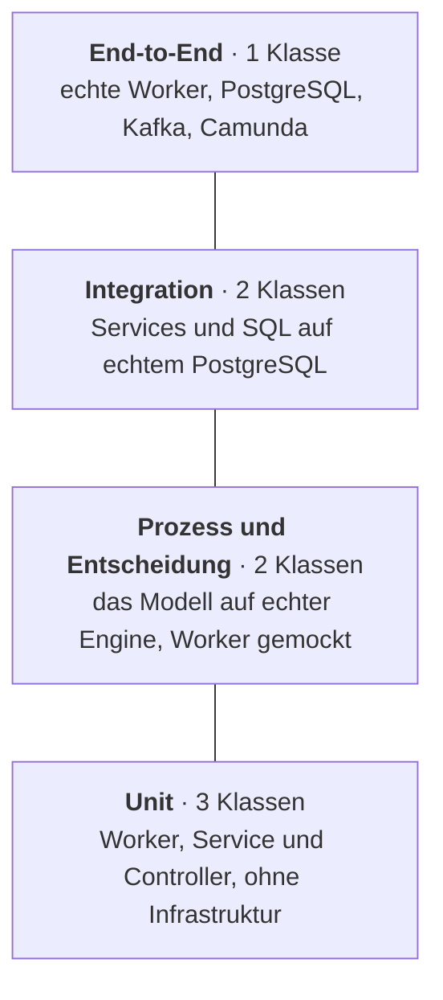

# Tests

[English](../en/testing.md) · **Deutsch**

Ein Workflow enthält zwei Arten von Logik: die Logik im Modell (Gateways, Timer, Nachrichten, Kompensation) und die
Logik im Code (Bestand, Rechnungen, SQL). Die Tests behandeln sie getrennt, weil sie aus unterschiedlichen Gründen
fehlschlagen und unterschiedliche Werkzeuge brauchen. Die Entscheidung dazu ist
[ADR 0008](adr/0008-test-pyramid-with-camunda-process-test.md).



## Tests ausführen

| Befehl | Was läuft | Benötigt |
| --- | --- | --- |
| `./mvnw test` | Unit-, Prozess- und Entscheidungstests (`*Test`) | Docker (die Prozesstests starten Camunda in einem Container) |
| `./mvnw verify` | alles oben, danach Integrations- und End-to-End-Tests (`*IT`), danach der Coverage-Bericht | Docker |
| `./mvnw test -Dtest=OrderToCashProcessTest` | eine Testklasse | Docker |
| `./mvnw verify -Dtest=none -Dsurefire.failIfNoSpecifiedTests=false -Dit.test=OrderToCashIT` | nur der End-to-End-Test | Docker |

Der JaCoCo-Bericht fasst Unit- und Integrationstests zusammen: `target/site/jacoco/index.html`. Die CI führt
`./mvnw verify` bei jedem Push und Pull Request aus.

## Prozesstests

[`OrderToCashProcessTest`](../../src/test/java/io/github/ahadporkar/ordertocash/process/OrderToCashProcessTest.java)
nutzt [Camunda Process Test](https://docs.camunda.io/docs/apis-tools/testing/getting-started/). Er startet eine echte
Camunda-8-Engine in einem Container, rollt BPMN, DMN und Formular aus und ersetzt jeden Job Worker durch einen Mock.
Damit testen diese Tests nur das Modell: Ist eine Gateway-Bedingung falsch oder liest ein Timer die falsche Variable,
schlagen sie fehl, ganz gleich, wie gut der Java-Code ist.

| Test | Weg durch das Modell |
| --- | --- |
| `standardOrderIsShippedAfterPayment` | keine Freigabe, Zahlung korreliert, versandt; prüft die Reihenfolge der abgeschlossenen Elemente |
| `largeGoldOrderNeedsApproval` | User Task für die Gruppe `sales` erzeugt, freigegeben, wartet auf Zahlung |
| `declinedOrderEndsDeclined` | User Task abgelehnt, Kunde mit Ergebnis `DECLINED` informiert |
| `soldOutOrderIsRejected` | Bestandsprüfung negativ, Kunde mit `REJECTED_OUT_OF_STOCK` informiert |
| `stockRunningOutDuringReservationRejectsTheOrder` | BPMN-Fehler `OUT_OF_STOCK` an *Reserve stock* abgefangen |
| `unpaidOrderIsCompensatedAfterTheDeadline` | 10 Tage: Erinnerung, Instanz wartet weiter; 4 weitere Tage: Kompensation von Bestand und Rechnung, Stornierung |
| `earlyPaymentIsBuffered` | Zahlung veröffentlicht, bevor die Instanz existiert, später korreliert |
| `duplicatePaymentIsIgnored` | der produktive `PaymentCorrelator` veröffentlicht dieselbe Zahlung zweimal; die zweite wird abgelehnt, die Bestellung einmal versandt |

Timer werden mit `processTestContext.increaseTime(...)` getestet, das die Uhr der Engine vorstellt. Der Test für eine
unbezahlte Bestellung deckt zwei Wochen Wartezeit ab und läuft in wenigen Sekunden. Die Dauern stammen aus der
Entscheidungstabelle; der Test beweist also auch, dass die Timer `approval.reminderAfter` und `approval.paymentTerm`
richtig lesen.

Mocks werden je Job-Typ definiert, sodass die Tests auch zeigen, welche Job-Typen das Modell erwartet:

```java
processTestContext.mockJobWorker(JobTypes.RESERVE_STOCK).thenThrowBpmnError(ProcessConstants.ERROR_OUT_OF_STOCK);
JobWorkerMock release = processTestContext.mockJobWorker(JobTypes.RELEASE_STOCK).thenComplete();
// ...
assertThat(release.getInvocations()).isEqualTo(1);
```

## Entscheidungstests

[`OrderApprovalDecisionTest`](../../src/test/java/io/github/ahadporkar/ordertocash/process/OrderApprovalDecisionTest.java)
wertet die Tabelle `order-approval` auf der Engine für jede Regel aus, auf beiden Seiten jedes Schwellenwerts
(49.999,99 und 60.000 für Gold, 1.000 und 1.000,01 für Neukunden, 10.000 und 10.000,01 für alle anderen). Er prüft das
Ergebnis und auch, *welche Regel gegriffen hat*. Bei der Hit Policy FIRST kann eine Regel in der falschen Zeile das
richtige Ergebnis aus dem falschen Grund liefern; die Prüfung des Regelindex deckt das auf.

## Unit-Tests

- [`InventoryWorkersTest`](../../src/test/java/io/github/ahadporkar/ordertocash/process/InventoryWorkersTest.java):
  Eine fachliche Ausnahme (`OutOfStockException`) wird zum BPMN-Fehler; eine technische Ausnahme bleibt eine Ausnahme,
  damit die Engine sie wiederholt und am Ende einen Incident meldet, statt einen fachlichen Weg zu nehmen.
- [`OrderServiceTest`](../../src/test/java/io/github/ahadporkar/ordertocash/order/OrderServiceTest.java): die
  Reihenfolge beim Anlegen einer Bestellung ([ADR 0007](adr/0007-commit-the-order-before-starting-the-process.md)),
  Preise aus dem Katalog und was passiert, wenn die Engine nicht erreichbar ist.
- [`OrderControllerTest`](../../src/test/java/io/github/ahadporkar/ordertocash/order/OrderControllerTest.java):
  Statuscodes (`201` mit `Location`, `400`, `404`, `202`, `409`) und Validierung, mit gemocktem Service.

## Integrationstests

[`InventoryServiceIT`](../../src/test/java/io/github/ahadporkar/ordertocash/inventory/InventoryServiceIT.java) und
[`OutboxRepositoryIT`](../../src/test/java/io/github/ahadporkar/ordertocash/events/OutboxRepositoryIT.java) führen die
Flyway-Migrationen auf PostgreSQL 16 in einem Container aus. Eine In-Memory-Datenbank würde genau das verbergen,
worauf es hier ankommt: `ON CONFLICT DO NOTHING`, `FOR UPDATE SKIP LOCKED`, partielle Indizes und Check-Constraints.

Sie belegen die Idempotenzregeln, auf die sich die Worker verlassen: Zweimal reservieren entnimmt den Bestand einmal,
eine Reservierung, die nicht vollständig bedient werden kann, reserviert gar nichts, zweimal freigeben bucht einmal
zurück, und dasselbe Ereignis wird einmal gespeichert und einmal weitergeleitet. Außerdem prüfen sie, dass die
Ereignisse einer Bestellung ohne Prozessinstanz zurückgehalten werden.

## End-to-End-Test

[`OrderToCashIT`](../../src/test/java/io/github/ahadporkar/ordertocash/OrderToCashIT.java) startet die gesamte
Spring-Boot-Anwendung mit ihren echten Workern gegen PostgreSQL, Kafka und Camunda (alle in Containern):

1. Eine Bestellung wird per HTTP angelegt, die Zahlung in das Topic `payments` geschrieben, die Bestellung erreicht
   `SHIPPED`, und die Ereignisse `OrderReceived`, `OrderInvoiced` und `OrderShipped` werden in dieser Reihenfolge aus
   der Outbox weitergeleitet.
2. Eine unbezahlte Bestellung: Die Uhr springt 15 Tage vor, die Bestellung erreicht `CANCELLED`, der Bestand ist
   zurück und die Rechnung storniert. Dies ist der Test, der die Kompensation gegen die echte Datenbank belegt.
3. Ein ausverkauftes Produkt: Die Bestellung erreicht `REJECTED`.

## Was nicht automatisch getestet wird

- Last und Performance. Der Durchsatz der Job Worker hängt von `max-jobs-active`, dem Datenbank-Pool und den
  Partitionen der Engine ab; dafür braucht es einen eigenen Test in einer passend dimensionierten Umgebung.
- Die Oberflächen von Operate und Tasklist.
- Die Compose-Datei über `docker compose config` hinaus; den Image-Build prüft die CI, den gesamten Stack
  `scripts/demo.sh` auf einem Entwicklerrechner.
