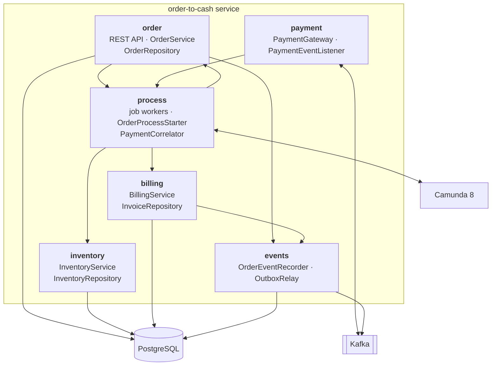
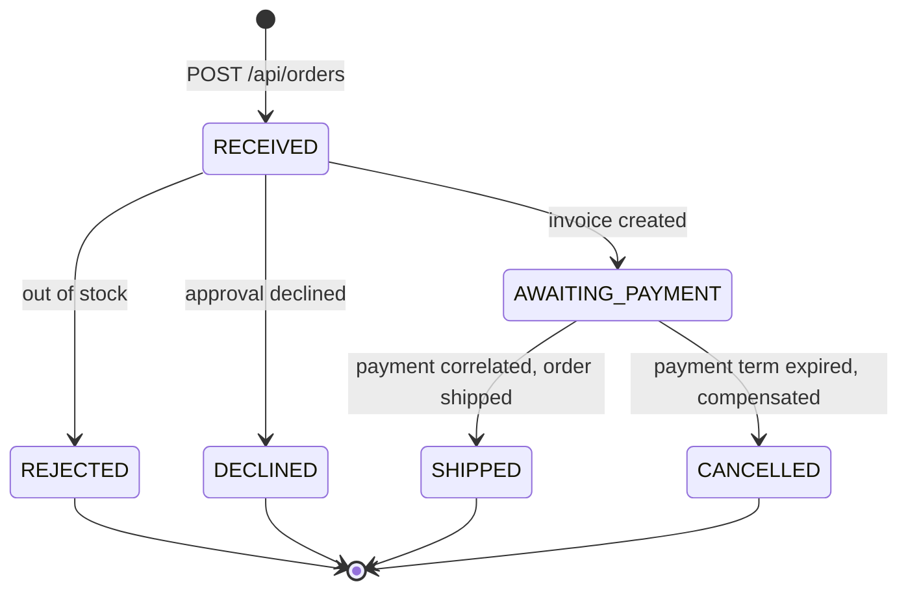
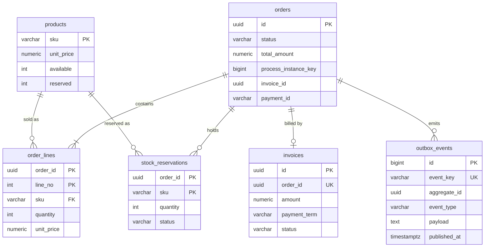
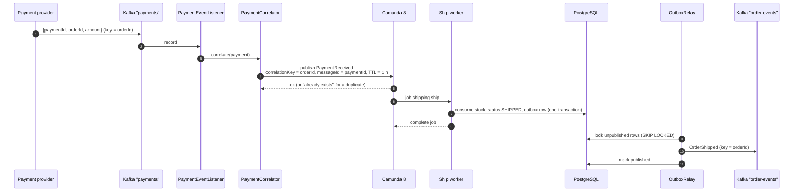

# Architecture

**English** · [Deutsch](../de/architecture.md)

This document explains how the order-to-cash service is built: its parts, how an order moves through the process,
what is stored where, and what happens when something fails. The decisions behind it are recorded as
[ADRs](adr/README.md).

## 1. Scope and quality goals

The service takes orders, reserves stock, issues invoices, waits for payment and ships. Customers, payments and
shipping are simplified, because the subject of this repository is the orchestration around them.

| Quality goal | What it means here | How it is reached |
| --- | --- | --- |
| Correctness under retries | No order ships twice, no stock is reserved twice, no invoice is issued twice | Idempotent services, unique keys, message ids ([ADR 0002](adr/0002-idempotent-job-workers.md)) |
| Recoverability | Every order ends in a defined status, even if it is never paid | Timers and compensation in the model ([ADR 0003](adr/0003-compensation-instead-of-distributed-transactions.md)) |
| Visibility | Anyone can see where an order is and why | One process instance per order, visible in Operate |
| Changeability | Sales can change approval limits and payment terms | Rules in a DMN table ([ADR 0004](adr/0004-business-rules-in-a-dmn-table.md)) |
| Testability | Every path can be tested in seconds, including those that take weeks | Camunda Process Test with a controlled clock ([ADR 0008](adr/0008-test-pyramid-with-camunda-process-test.md)) |

## 2. Building blocks



| Package | Responsibility | Talks to |
| --- | --- | --- |
| `order` | REST API, pricing, order status, order lifecycle | database, process start, outbox |
| `inventory` | stock check, reservation, release, consumption | database |
| `billing` | invoice creation and cancellation | database, outbox |
| `process` | job workers (thin adapters), starting instances, publishing the payment message | Camunda, the services above |
| `payment` | payment gateway (`kafka` or `direct`) and the Kafka listener | Kafka, `PaymentCorrelator` |
| `events` | writes events to the outbox in the caller's transaction, relays them to Kafka | database, Kafka |

Two rules keep the parts apart. First, **the process knows business keys, not business data**: an instance carries
`orderId`, `customerId`, `customerSegment`, `totalAmount` and `currency`, but never the order lines; workers load
what they need from the database. Second, **workers contain no business logic**: they translate between job variables
and a service call, and between a business exception and a BPMN error.

## 3. The process, step by step


| BPMN element | Job type | Service call | Effect in the database | Order event |
| --- | --- | --- | --- | --- |
| Check inventory | `inventory.check` | `InventoryService.isAvailable` | none (read only) | |
| Decide approval and payment terms | (DMN `order-approval`) | | | |
| Approve order | (user task, form `approve-order`) | | | |
| Reserve stock | `inventory.reserve` | `InventoryService.reserve` | `available` down, `reserved` up, one reservation per SKU | |
| Create invoice | `invoice.create` | `BillingService.createInvoice` | invoice row; order `AWAITING_PAYMENT` | `OrderInvoiced` |
| Wait for payment | (message `PaymentReceived`) | | | |
| Ship order | `shipping.ship` | `OrderService.ship` | reservations `SHIPPED`, `reserved` down; order `SHIPPED` | `OrderShipped` |
| Send payment reminder | `customer.notify` | `OrderService.recordOutcome` | none | `PaymentReminderDue` |
| Release stock (compensation) | `inventory.release` | `InventoryService.release` | reservations `RELEASED`, stock returned | |
| Cancel invoice (compensation) | `invoice.cancel` | `BillingService.cancelInvoice` | invoice `CANCELLED` | `InvoiceCancelled` |
| Cancel order | `order.cancel` | `OrderService.cancel` | order `CANCELLED` | `OrderCancelled` |
| Inform customer (declined / out of stock) | `customer.notify` | `OrderService.recordOutcome` | order `DECLINED` / `REJECTED` | `OrderDeclined` / `OrderRejected` |

The decision table returns one object, `approval`, with three fields:

| Segment | Order total | `approvalRequired` | `paymentTerm` | `reminderAfter` |
| --- | --- | --- | --- | --- |
| `GOLD` | ≥ 50,000 | yes | 30 days | 21 days |
| `GOLD` | any | no | 30 days | 21 days |
| `NEW` | > 1,000 | yes | 7 days | 5 days |
| `NEW` | any | no | 7 days | 5 days |
| any | > 10,000 | yes | 14 days | 10 days |
| any | any | no | 14 days | 10 days |

The two timers on *Wait for payment* read their durations from it: `=approval.reminderAfter` for the
non-interrupting reminder and `=approval.paymentTerm` for the interrupting deadline. The invoice stores the same term.

## 4. Order status



The status is a projection of the process for the API and for reports. The process instance remains the source of
truth for *where* an order is; the status column answers *what* it is. Status updates are conditional
(`WHERE status <> :status`), so a repeated job does not record a second event.

## 5. Data model



The keys carry the idempotency rules: one reservation per order and SKU, one invoice per order, one event per order and
event type. Stock is taken with a single conditional update (`available >= :qty`), so two orders cannot oversell the
last item and no row lock is held across a network call.

## 6. Payments in, events out



Payment records and order events are both keyed by order id, so everything about one order stays in one partition and
in order. `OrderReceived` is written in the same transaction as the order itself, so it is always the order's first
event; the relay holds an order's events back until the order has its process instance, so an order whose process
could not be started is never announced. An event on `order-events` looks like this:

```json
{
  "type": "OrderShipped",
  "orderId": "1f0c6c3e-8a51-4c9e-9d4b-2b8f3c7a9e10",
  "status": "SHIPPED",
  "occurredAt": "2026-10-01T09:30:12.481Z",
  "details": { "paymentId": "pay-7781" }
}
```

Event types: `OrderReceived`, `OrderInvoiced`, `PaymentReminderDue`, `OrderShipped`, `OrderRejected`, `OrderDeclined`,
`InvoiceCancelled`, `OrderCancelled`.

## 7. When things go wrong

| Failure | What happens | Why it is safe |
| --- | --- | --- |
| A worker crashes after its database commit but before completing the job | The job times out and is activated again | The service call is idempotent; the second call is a no-op |
| A worker throws an unexpected exception | The job gets up to three attempts (`retries="3"` in the model), then an incident appears in Operate | Nothing is half done: each service call is one transaction |
| Stock runs out between check and reservation | The worker throws the BPMN error `OUT_OF_STOCK` | The reservation transaction rolled back; the model takes the rejection path |
| The engine is unreachable when an order is placed | The stored order and its unpublished `OrderReceived` event are deleted again; the API returns `503` | No order exists without a process instance ([ADR 0007](adr/0007-commit-the-order-before-starting-the-process.md)) |
| The same payment is delivered twice | The second publish is rejected because the message id exists | The order ships once ([ADR 0005](adr/0005-payments-via-kafka-with-message-id-and-ttl.md)) |
| A payment arrives before the instance waits | The message waits in the engine for up to one hour | It is correlated when the instance reaches *Wait for payment* |
| A payment record is not valid JSON | It goes straight to `payments-dlt`; other failures are retried 3 times first | One bad record does not block the partition |
| Kafka is down | Order events stay in the outbox; payments cannot be submitted (`/payments` fails) | The relay publishes the backlog when Kafka is back ([ADR 0006](adr/0006-transactional-outbox-for-order-events.md)) |
| The relay crashes after sending but before marking a row | The event is sent again | Consumers deduplicate by order id and event type |
| The customer never pays | Reminder after `reminderAfter`, deadline after `paymentTerm` | Compensation releases stock and cancels the invoice, then the order is cancelled |
| A payment arrives after cancellation | The API rejects it with `409`; a payment on Kafka finds no waiting instance and expires | Refunds are outside the scope of this service |

## 8. Deploying models and versions

On startup the service deploys the BPMN process, the DMN decision and the form (`@Deployment`). An unchanged resource
does not create a new version. A changed one does, and **running instances stay on the version they started with**,
while new orders use the latest version. Instances are started with `latestVersion()` on purpose; a model change that
must reach running instances is a migration, done explicitly with Operate's process instance migration. The process
also carries a version tag (`1.0.0`) that ties a deployed version to a release of this repository.

## 9. Observing the system

- **Operate** shows every instance, its current position, its variables and any incident.
- **Tasklist** shows open approval tasks for the `sales` group.
- **Actuator** exposes `/actuator/health` with liveness and readiness probes and `/actuator/prometheus` with JVM,
  HTTP, Kafka and job worker metrics.
- **Logs**: business messages name the order id, so one order can be followed across workers.
- **The outbox** answers "what did we tell the world about this order?": `SELECT event_type, published_at FROM
  outbox_events WHERE aggregate_id = ?`.

## 10. Security notes

- Prices and totals are always computed on the server from the catalog; the client sends only SKUs and quantities.
- Input is validated (sizes, ranges, at most 20 lines) and errors are returned as problem details without stack
  traces.
- The container image runs as a non-root user.
- Not included, because this is a reference implementation: authentication on the API, TLS, and secrets
  management. The compose file uses the Camunda demo user and plain passwords and must not be used outside a local
  machine.
