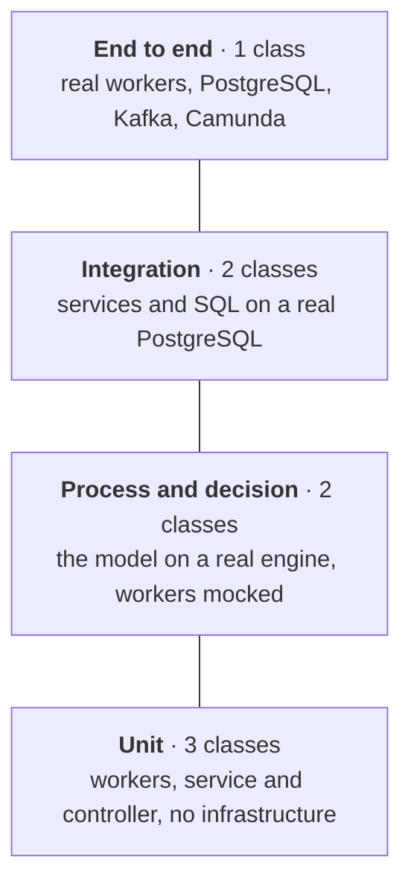

# Testing

**English** · [Deutsch](../de/testing.md)

A workflow has two kinds of logic: the logic in the model (gateways, timers, messages, compensation) and the logic in
the code (stock, invoices, SQL). The tests treat them separately, because they fail for different reasons and need
different tools. The decision behind this split is [ADR 0008](adr/0008-test-pyramid-with-camunda-process-test.md).



## Running the tests

| Command | What runs | Needs |
| --- | --- | --- |
| `./mvnw test` | unit, process and decision tests (`*Test`) | Docker (the process tests start Camunda in a container) |
| `./mvnw verify` | everything above, then integration and end-to-end tests (`*IT`), then the coverage report | Docker |
| `./mvnw test -Dtest=OrderToCashProcessTest` | one test class | Docker |
| `./mvnw verify -Dtest=none -Dsurefire.failIfNoSpecifiedTests=false -Dit.test=OrderToCashIT` | only the end-to-end test | Docker |

The JaCoCo report covers unit and integration tests together: `target/site/jacoco/index.html`. CI runs
`./mvnw verify` on every push and pull request.

## Process tests

[`OrderToCashProcessTest`](../../src/test/java/io/github/ahadporkar/ordertocash/process/OrderToCashProcessTest.java)
uses [Camunda Process Test](https://docs.camunda.io/docs/apis-tools/testing/getting-started/). It starts a real
Camunda 8 engine in a container, deploys the BPMN, DMN and form, and replaces every job worker with a mock. That makes
the tests about the model only: if a gateway condition is wrong or a timer reads the wrong variable, these tests fail,
no matter how good the Java code is.

| Test | Path through the model |
| --- | --- |
| `standardOrderIsShippedAfterPayment` | no approval, payment correlated, shipped; checks the order of completed elements |
| `largeGoldOrderNeedsApproval` | user task created for group `sales`, approved, waits for payment |
| `declinedOrderEndsDeclined` | user task declined, customer informed with outcome `DECLINED` |
| `soldOutOrderIsRejected` | stock check negative, customer informed with `REJECTED_OUT_OF_STOCK` |
| `stockRunningOutDuringReservationRejectsTheOrder` | BPMN error `OUT_OF_STOCK` caught at *Reserve stock* |
| `unpaidOrderIsCompensatedAfterTheDeadline` | 10 days: reminder, instance still waiting; 4 more days: compensation of stock and invoice, cancellation |
| `earlyPaymentIsBuffered` | payment published before the instance exists, correlated later |
| `duplicatePaymentIsIgnored` | the production `PaymentCorrelator` publishes the same payment twice; the second is rejected, the order ships once |

Timers are tested with `processTestContext.increaseTime(...)`, which moves the engine's clock. The test for an unpaid
order covers two weeks of waiting and runs in a few seconds. The durations come from the decision table, so this test
also proves that the timers read `approval.reminderAfter` and `approval.paymentTerm` correctly.

Mocks are defined per job type, so the tests also show which job types the model expects:

```java
processTestContext.mockJobWorker(JobTypes.RESERVE_STOCK).thenThrowBpmnError(ProcessConstants.ERROR_OUT_OF_STOCK);
JobWorkerMock release = processTestContext.mockJobWorker(JobTypes.RELEASE_STOCK).thenComplete();
// ...
assertThat(release.getInvocations()).isEqualTo(1);
```

## Decision tests

[`OrderApprovalDecisionTest`](../../src/test/java/io/github/ahadporkar/ordertocash/process/OrderApprovalDecisionTest.java)
evaluates the `order-approval` table on the engine for each rule, on both sides of each threshold (49,999.99 and 60,000
for gold, 1,000 and 1,000.01 for new customers, 10,000 and 10,000.01 for everyone else). It checks the output and also
*which rule matched*. With hit policy FIRST, a rule placed in the wrong row can return the right answer for the wrong
reason; asserting the rule index catches that.

## Unit tests

- [`InventoryWorkersTest`](../../src/test/java/io/github/ahadporkar/ordertocash/process/InventoryWorkersTest.java):
  a business exception (`OutOfStockException`) becomes a BPMN error; a technical exception stays an exception, so the
  engine retries it and eventually raises an incident instead of taking a business path.
- [`OrderServiceTest`](../../src/test/java/io/github/ahadporkar/ordertocash/order/OrderServiceTest.java): the
  order of steps when an order is placed ([ADR 0007](adr/0007-commit-the-order-before-starting-the-process.md)),
  prices from the catalog, and what happens when the engine is unreachable.
- [`OrderControllerTest`](../../src/test/java/io/github/ahadporkar/ordertocash/order/OrderControllerTest.java):
  status codes (`201` with `Location`, `400`, `404`, `202`, `409`) and validation, with the service mocked.

## Integration tests

[`InventoryServiceIT`](../../src/test/java/io/github/ahadporkar/ordertocash/inventory/InventoryServiceIT.java) and
[`OutboxRepositoryIT`](../../src/test/java/io/github/ahadporkar/ordertocash/events/OutboxRepositoryIT.java) run the
Flyway migrations on PostgreSQL 16 in a container. An in-memory database would hide exactly what matters here:
`ON CONFLICT DO NOTHING`, `FOR UPDATE SKIP LOCKED`, partial indexes and check constraints.

They prove the idempotency rules the workers rely on: reserving twice takes stock once, a reservation that cannot be
served completely reserves nothing, releasing twice returns stock once, and the same event is stored once and relayed
once. They also check that the events of an order without a process instance are held back.

## End-to-end test

[`OrderToCashIT`](../../src/test/java/io/github/ahadporkar/ordertocash/OrderToCashIT.java) starts the whole Spring
Boot application with its real workers against PostgreSQL, Kafka and Camunda (all in containers):

1. An order is placed over HTTP, the payment is published to the `payments` topic, the order reaches `SHIPPED`, and the
   events `OrderReceived`, `OrderInvoiced` and `OrderShipped` are relayed from the outbox in that order.
2. An unpaid order: the clock moves 15 days, the order reaches `CANCELLED`, the stock is back and the invoice is
   cancelled. This is the one test that proves compensation against the real database.
3. A sold-out product: the order reaches `REJECTED`.

## What is not tested automatically

- Load and performance. Job worker throughput depends on `max-jobs-active`, the database pool and the engine's
  partitions; this needs a separate test against a sized environment.
- The Operate and Tasklist user interfaces.
- The compose file beyond `docker compose config`; the image build is checked by CI, the full stack by
  `scripts/demo.sh` on a developer machine.
